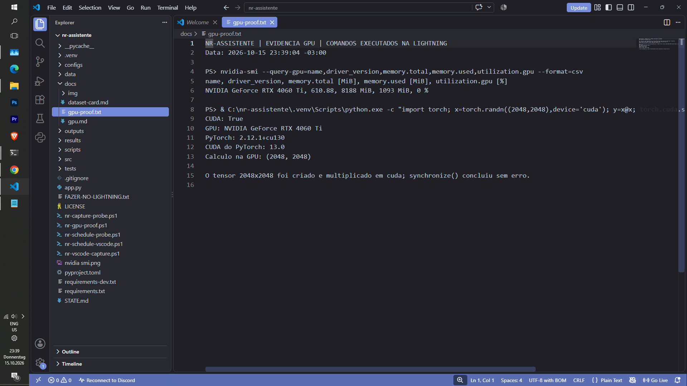

# Ambiente GPU na Lightning

## Evidência do hardware e do driver

Medição feita na Lightning em **15/10/2026 às 20:05:29 BRT
(23:05:29 UTC; 19:05:29 EDT no host)**, sem pausar a transcrição. Comando:

```powershell
nvidia-smi --query-gpu=timestamp,name,driver_version,memory.total,memory.used,memory.free,utilization.gpu,temperature.gpu,power.draw --format=csv
```

Saída real:

```text
timestamp, name, driver_version, memory.total [MiB], memory.used [MiB], memory.free [MiB], utilization.gpu [%], temperature.gpu, power.draw [W]
2026/10/15 20:05:29.157, NVIDIA GeForce RTX 4060 Ti, 610.88, 8188 MiB, 1589 MiB, 6361 MiB, 73 %, 64, 66.23 W
```

O cabeçalho do `nvidia-smi`, capturado na mesma sessão às 20:02:39
BRT, informou:

```text
NVIDIA-SMI 610.88    KMD Version: 610.88    CUDA UMD Version: 13.3
GPU 0: NVIDIA GeForce RTX 4060 Ti (WDDM)
```

Os valores de uso, temperatura e potência são apenas uma fotografia daquele
instante. A transcrição continuava em execução e também utilizava a GPU.

## Ambiente Python e PyTorch

O ambiente foi criado em `C:\nr-assistente\.venv` com Python 3.11.0. Foi
instalado o wheel oficial estável do PyTorch para CUDA 13.0, compatível com o
driver 610.88/CUDA UMD 13.3 observado:

```powershell
py -3.11 -m venv C:\nr-assistente\.venv
C:\nr-assistente\.venv\Scripts\python.exe -m pip install --upgrade pip
C:\nr-assistente\.venv\Scripts\python.exe -m pip install torch==2.12.1 --index-url https://download.pytorch.org/whl/cu130
```

Resultado real da instalação: `torch-2.12.1+cu130` instalado com sucesso. A
fonte do wheel foi o índice oficial `download.pytorch.org/whl/cu130`.

## Verificação CUDA

Em **15/10/2026 às 20:06:47 BRT (23:06:47 UTC)** foi executada uma multiplicação de matrizes
`2048 x 2048` diretamente em `cuda`, seguida de `torch.cuda.synchronize()`.
A saída real do script de verificação foi:

```json
{"bf16_supported": true, "compute_capability": [8, 9], "cuda_available": true, "cudnn": 92000, "device_count": 1, "device_name": "NVIDIA GeForce RTX 4060 Ti", "matmul_checksum": -47.103027, "matmul_shape": [2048, 2048], "python": "3.11.0", "torch": "2.12.1+cu130", "torch_cuda": "13.0", "total_memory_bytes": 8585216000}
```

Assim, `torch.cuda.is_available()` retornou **`True`** e uma operação real na
GPU foi concluída. O valor de memória reportado pelo PyTorch equivale aos
8.188 MiB exibidos pelo `nvidia-smi` (unidades e arredondamentos distintos).

Para repetir a checagem básica:

```powershell
C:\nr-assistente\.venv\Scripts\Activate.ps1
python -c "import torch; print(torch.__version__); print(torch.cuda.is_available()); print(torch.cuda.get_device_name(0)); print(torch.version.cuda)"
```

## Captura no VS Code

A captura real da sessão gráfica da Lightning foi feita em **15/10/2026 às
23:39 BRT**, com [o arquivo de saída dos comandos](gpu-proof.txt) aberto no
VSCode. O print está em [docs/img/vscode-gpu.png](img/vscode-gpu.png).
Os comandos exibidos no arquivo foram executados na Lightning por SSH, e a
captura mostra o arquivo aberto no VSCode da sessão gráfica ativa.

Para repetir a captura:

1. Abrir `C:\nr-assistente` no VS Code.
2. Pressionar `Ctrl+Shift+P`, escolher **Python: Select Interpreter** e apontar
   para `C:\nr-assistente\.venv\Scripts\python.exe`.
3. Abrir o terminal integrado do VS Code com `Ctrl+\`` e executar:

   ```powershell
   nvidia-smi
   C:\nr-assistente\.venv\Scripts\python.exe -c "import torch; x=torch.randn(2048,2048,device='cuda'); y=x@x; torch.cuda.synchronize(); print('CUDA:',torch.cuda.is_available(),'| GPU:',torch.cuda.get_device_name(0),'| PyTorch:',torch.__version__,'| cálculo na GPU:',y.shape)"
   ```

4. Manter visíveis no mesmo enquadramento a janela do VS Code, o `nvidia-smi`
   com `NVIDIA GeForce RTX 4060 Ti` e a saída `CUDA: True` e `cálculo na GPU`.
5. Usar `Win+Shift+S` e salvar como `docs/img/vscode-gpu.png`.


