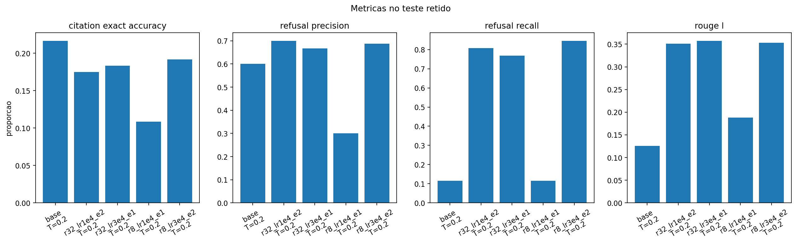
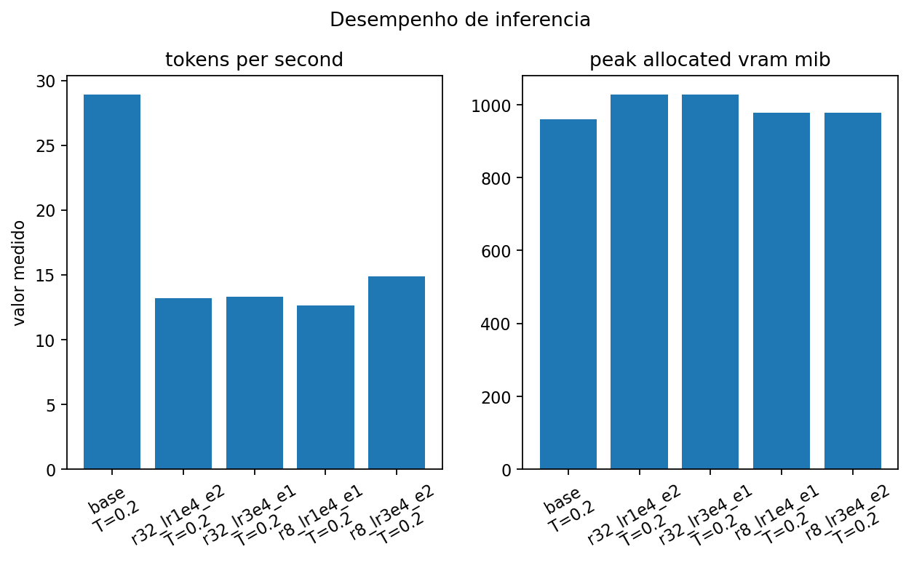
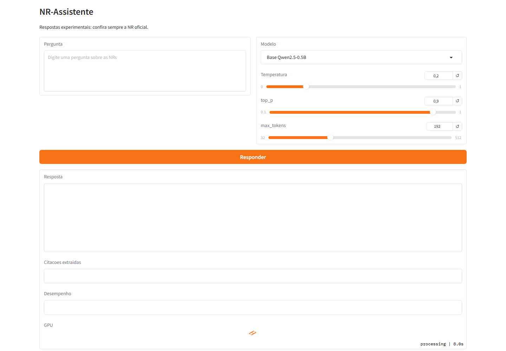

# Relatório técnico — NR-Assistente

**Data:** 15/10/2026. **Grupo:** Rafael Carvalho Mattos (RM 99874), Rafael Autieri dos Anjos
(RM 550885), Luiza Cristina Silva (RM 99367) e Levy Nascimento Junior (RM 98655).

## Objetivo e escolha do modelo

O problema é responder, em português, perguntas sobre sete Normas Regulamentadoras (NR-06, 10,
12, 17, 18, 33 e 35), citando NR e item, e recusar perguntas que o trecho consultado não sustenta.
Selecionamos `Qwen/Qwen2.5-0.5B-Instruct` (Apache-2.0) pelo tamanho adequado à RTX 4060 Ti de
8 GB e pela possibilidade de ajustar o modelo com LoRA. A hipótese era melhorar respostas e
recusas com dados sintéticos baseados em normas oficiais. O modelo 1,5B ficou fora deste recorte.

## Fontes e dataset

Os PDFs foram obtidos da página oficial do Ministério do Trabalho e Emprego; o
[`manifest.json`](../data/raw/manifest.json) registra URLs e hashes SHA-256. A extração separou
itens normativos. O Gemini `gemini-3.8-flash-medium` gerou **720** pares de pergunta e resposta
em **40** lotes aceitos. A validação local rejeitou **0** dos pares aceitos e o split por
`source_id` separou **600** para treino e **120** para teste, sem o mesmo item nos dois grupos.
Há **118** recusas no treino e **26** no teste. A geração sintética não garante correção jurídica;
nenhuma revisão humana integral foi realizada. Detalhes: [cartão do dataset](dataset-card.md).

## Ambiente e método

A GPU foi a **NVIDIA GeForce RTX 4060 Ti**, com 8.188 MiB de VRAM e driver 610.88 na Lightning.
O PyTorch `2.12.1+cu130` detectou CUDA 13.0 e executou uma multiplicação de matrizes na GPU.
Os quatro treinos e as 600 inferências de teste tiveram telemetria da GPU registrada em CSV.
Comandos e evidências estão em [gpu.md](gpu.md).

Treinamos adapters LoRA com sementes 47, sequência máxima 256, batch 2, acumulação 8,
`warmup_ratio=0,05` e `weight_decay=0,01`. Variamos rank, taxa de aprendizado e épocas:

| Run | Rank | Taxa | Épocas | Tempo | Loss final | Pico VRAM de treino |
|---|---:|---:|---:|---:|---:|---:|
| `q05_r8_lr1e4_e1` | 8 | 1e-4 | 1 | 90,6 s | 2,1155 | 5.572 MiB |
| `q05_r8_lr3e4_e2` | 8 | 3e-4 | 2 | 234,4 s | 1,2676 | 5.574 MiB |
| `q05_r32_lr1e4_e2` | 32 | 1e-4 | 2 | 222,6 s | 1,2518 | 5.792 MiB |
| `q05_r32_lr3e4_e1` | 32 | 3e-4 | 1 | 104,6 s | 1,3307 | 5.792 MiB |

Os valores vêm dos arquivos `outputs/<run>/training_result.json` e `nvidia-smi.csv`. A loss
é de treino; sozinha não mede correção de respostas nem se compara diretamente ao modelo base.

## Avaliação no conjunto retido

O mesmo teste de 120 pares foi usado para o modelo base e os quatro adapters, com temperatura
**0,2**, `top_p=0,9` e até **192** novos tokens. O teste não foi usado no treinamento.
Métricas brutas, previsões por caso e telemetria estão em [`results/eval`](../results/eval).

| Modelo | ROUGE-L | Recusas corretas / 26 | Precisão de recusa | Citação exata / 94 respondíveis | Tokens/s |
|---|---:|---:|---:|---:|---:|
| Base | 0,126 | 3 | 0,600 | 0 | 28,93 |
| r8, 1e-4, 1 época | 0,188 | 3 | 0,300 | 0 | 12,64 |
| r8, 3e-4, 2 épocas | 0,353 | **22** | 0,688 | **1** | 14,87 |
| r32, 1e-4, 2 épocas | 0,351 | 21 | **0,700** | 0 | 13,18 |
| r32, 3e-4, 1 época | **0,357** | 20 | 0,667 | **1** | 13,29 |

**Interpretação:** a configuração r8, 3e-4, 2 épocas melhorou a semelhança lexical e a
sensibilidade para perguntas sem resposta. Contudo, sua precisão de recusa de 0,688 indica
falsas recusas, e acertou a citação exata em apenas **1 de 94** perguntas respondíveis. A
métrica `citation_exact_accuracy` no resumo bruto contabiliza também as 26 recusas, que não
exigem citação; por isso o valor bruto de 0,192 **não significa** que 19,2% das citações em
respostas substantivas estejam corretas. Fizemos a contagem condicional diretamente das
previsões individuais. Não há base para recomendar o modelo em uso profissional.

Uma inspeção de resposta mostra o erro: à pergunta sobre serviços elétricos não rotineiros,
a referência exige permissão de trabalho e cita **NR-10 item 10.7.2**. O melhor adapter
respondeu com “Certificados de Conformidade” e citou **NR-18 item 18.5.2.3**. Esse caso está
registrado no arquivo de previsões e ilustra a necessidade de conferir cada resposta.

Como complemento exploratório, o Gemini `gemini-3.8-flash-medium` pontuou as mesmas **10**
perguntas para cada um dos cinco modelos, de 0 a 2 em correção, fundamentação e utilidade.
A média de correção foi **0,1** no base, **0,6** no r8/3e-4/2 épocas, **0,8** no
r32/1e-4/2 épocas, **0,6** no r32/3e-4/1 época e **0,0** no r8/1e-4/1 época.
Os registros estão em [`gemini_judge.jsonl`](../results/eval/gemini_judge.jsonl).
Esta amostra é pequena, usa como juiz a mesma família de modelo que gerou as referências e
não substitui revisão humana. A comparação principal continua sendo a dos 120 casos.

## Interface e reprodução

`app.py` implementa uma interface Gradio com campo de pergunta, escolha entre modelo base e
adapters disponíveis, controles de temperatura, `top_p` e limite de tokens, resposta, citações
extraídas, velocidade e utilização da GPU. Ela foi instanciada na Lightning com os cinco modelos
visíveis e a RTX 4060 Ti detectada. O adapter de melhor compromisso foi incluído no repositório.
As instruções de instalação, treino, avaliação e execução estão no [README](../README.md).

## Limitações e próximos passos

O recorte cobre sete NRs e usa dados gerados automaticamente. Há somente uma semente e uma
temperatura na comparação completa. ROUGE-L mede semelhança lexical e não prova correção
jurídica. A avaliação de citação exata é especialmente ruim. Antes de qualquer uso real,
seriam necessários revisão humana do dataset, recuperação confiável dos itens oficiais,
verificação determinística da citação e nova avaliação com especialistas. Testar o Qwen 1,5B,
outras temperaturas e mais sementes também fica para um experimento posterior.
